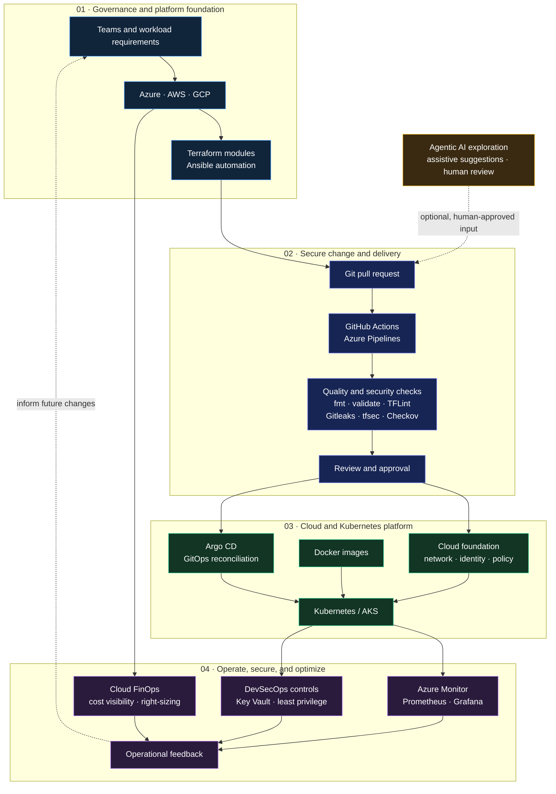

  

<h1 align="center">
  
</h1>

  

  
  
  
  

  <a href="#about-me">About</a> ·
  <a href="#delivery-map">Delivery Map</a> ·
  <a href="#technology-stack">Technology Stack</a> ·
  <a href="#portfolio-projects">Projects</a> ·
  <a href="#devsecops-approach">DevSecOps</a> ·
  <a href="#current-focus">Current Focus</a> ·
  <a href="#connect">Connect</a>

---

## 👋 About Me

I’m a **DevOps & DevSecOps Engineer** with four years of experience across cloud infrastructure, automation, and CI/CD. I work primarily with **Microsoft Azure and Terraform**, building practical infrastructure examples around networking, secure cloud resources, and Kubernetes.

I care about keeping infrastructure changes understandable, automating repeatable checks, and considering security and operations throughout delivery. I’m also exploring **Agentic AI** and **Cloud FinOps** as areas of interest.

## 🧭 Portfolio Delivery Map

An enterprise-oriented reference flow showing how my key skills fit together, from a reviewed infrastructure change to secure platform operations. This is an architecture view, not a claim that the portfolio labs deploy these systems: their workflows validate and scan Terraform; they **do not deploy cloud resources**.

## 🧰 Technology Stack

| Area | Tools and technologies |
| --- | --- |
| ☁️ Cloud | Microsoft Azure, AWS, GCP |
| 🏗️ Infrastructure as Code | Terraform, Ansible |
| 📦 Containers and orchestration | Docker, Kubernetes, AKS |
| 🔁 CI/CD and GitOps | GitHub Actions, Azure Pipelines, Azure DevOps, Argo CD, Git |
| 🔐 Infrastructure security | Gitleaks, TFLint, tfsec, Checkov, Azure Key Vault |
| 📊 Monitoring and scripting | Prometheus, Grafana, Azure Monitor, Bash, Linux |
| 🧪 Current interests | Agentic AI, infrastructure automation, Cloud FinOps |

  

## 🚀 Portfolio Projects

These projects demonstrate Terraform module composition and CI validation patterns. They are learning examples, not production deployments; review prerequisites and environment-specific requirements before adapting them.

### ☁️ Azure Foundation

A Terraform root module that composes a network child module.

- Creates a virtual network with configurable subnets.
- Associates network security groups with subnets.
- Demonstrates reusable module inputs and outputs.
- Includes CI checks for formatting, validation, linting, and IaC configuration.

### 🌐 Hub-and-Spoke Network

A modular example for connecting hub and spoke virtual networks.

- Uses reusable VNet child modules for the hub and spokes.
- Configures bidirectional network peering.
- Leaves routing, firewall, gateway, and production-specific controls to the target design.

### 🔐 Secure Data Platform

A Terraform example that composes separate Storage Account and Key Vault modules.

- Keeps storage and secrets resources in their own child modules.
- Documents secure defaults and access prerequisites.
- Requires a suitable network and access design before adaptation.

### ☸️ AKS Platform

A network and AKS module composition for a private-cluster-oriented baseline.

- Uses managed identity and Azure RBAC.
- Configures an autoscaling system node pool.
- Includes GitHub Actions and Azure Pipelines validation definitions.
- Needs environment-specific review of access, networking, and operations.

## 🔒 DevSecOps Approach

I aim to make security checks part of the normal development workflow, with results that engineers can review and act on.

- **Review infrastructure changes:** Check Terraform plans and configuration changes before applying them.
- **Run checks early:** Use formatting, validation, linting, and IaC scans during CI.
- **Protect secrets:** Use secret-scanning tools and keep credentials and state out of source control.
- **Use scoped access:** Prefer permissions appropriate to the pipeline or task.
- **Make requirements visible:** Document network access, prerequisites, and limitations.
- **Keep examples honest:** Clearly distinguish portfolio labs from production-ready platform designs.

## 🛠️ How I Work

1. **Understand the requirement** — clarify the environment, constraints, and intended outcome.
2. **Model the change** — keep infrastructure definitions version-controlled and modular where useful.
3. **Validate automatically** — run repeatable checks before a change is considered ready.
4. **Review the impact** — look for unexpected changes and security or access implications.
5. **Improve from feedback** — use operational lessons to make modules and workflows clearer.

## 🎯 Current Focus

- Building a stronger portfolio of Azure and Terraform infrastructure examples.
- Improving reusable module patterns and CI validation workflows.
- Learning more about Kubernetes platform operations and observability.
- Exploring safe, reviewable uses of Agentic AI in DevOps workflows.
- Keeping cloud cost awareness alongside reliability and security considerations.

## 📈 GitHub Activity

  
  

  

## 🤝 Connect

Interested in cloud infrastructure, DevOps, DevSecOps, or automation? Explore my repositories and connect on [GitHub](https://github.com/rahulbhatt773).

  

